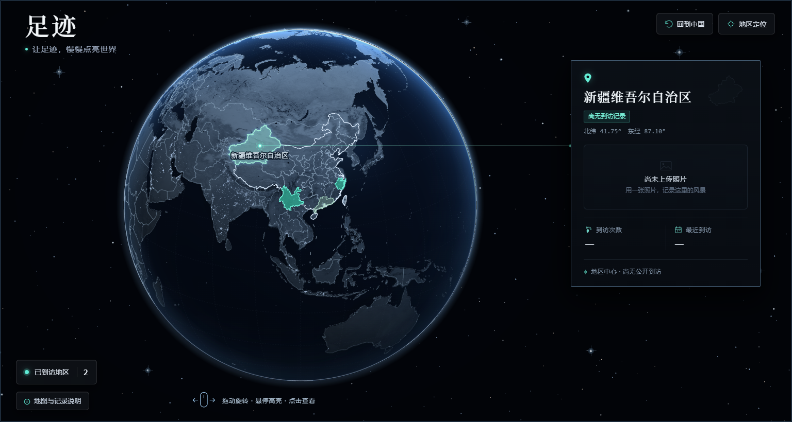

# 🌍 Footprint Globe · 足迹数字地球

> 一个兼具**天文台球面材质**与 <strong>人文地理杂志质感（玄墨微金）</strong> 的开源个人旅行足迹数字地球。  
> 基于 **WebGL (NASA Blue Marble + Black Marble 昼夜地形着色器)** 与 **D3.js 正交球面投影 (Natural Earth 公共领域地理边界)** 构建，零前端框架锁定，开箱即用。



---

## ✨ 核心特性 (Features)

1. **双引擎混合球面渲染 (WebGL + D3 Orthographic SVG)**
   - **底层 WebGL 着色器**：实时渲染 4096×2048 **NASA Blue Marble Next Generation** 地形起伏、海洋高光反射、**NASA Black Marble** 历史夜间城市灯光，以及方向性冷蓝大气散射（Grazing & Limb Halo）。
   - **上层 D3 矢量边界**：精准对齐中国省级行政区与全球国家/海外分离地区（如夏威夷、阿拉斯加独立点亮），并在 WebGL 上下文丢失或受限设备上自动优雅降级为纯 SVG 渲染。
   - **透光地形点亮与边缘消隐**：点亮省份保留 `62%~64%` 透光度，自然透出底层的山脉地形与城市夜光；球体边缘（Limb）配备静止径向消隐层，拖动旋转帧率稳定在 `p50 ≈ 7ms`。

2. **玄墨微金 · 人文地理杂志风档案卡 (Editorial Detail Card)**
   - 摒弃廉价的“政务大屏科技蓝”，采用**深玄墨底色 (`#131316`) + 象牙暖白衬线标题 (`#eeeae4`) + 亚麻暖灰等宽坐标 (`#8f8a82`) + 低饱和香槟微金点缀 (`#c8ab83`)**。
   - 右上角实时生成所选省/国的真实 Mercator 地理轮廓暗金压印（`#card-region-shape`）。
   - 球面坐标至右侧固定档案卡之间由动态 `userSpaceOnUse` 冷暖渐变折线引线连接，卡片位置固定不跳动。

3. **视口级稳定星空与完整无障碍交互 (Viewport-Fixed Starfield & A11y)**
   - 星空画布按窗口尺寸锁定缓存，展开/收起卡片绝不拉伸或重绘背景。
   - 完整支持鼠标拖拽、触屏单指旋转、键盘方向键旋转、`Home` 键一键回到常居地、`Esc` 取消选中、下拉地区定位器以及 `prefers-reduced-motion` 减少动态模式。

4. **100% 开源合规数据 (Public Domain & Permissive Assets)**
   - 地理边界数据来自 **Natural Earth**（Public Domain 公共领域）；
   - 地球昼夜纹理来自 **NASA Earth Observatory**（Public Domain）；
   - 球面几何计算基于 **D3.js**（ISC License）。

---

## 🚀 快速开始 (Quick Start)

### 1. 安装与本地运行

```bash
git clone https://github.com/Over9rowth/footprint-globe.git
cd footprint-globe
npm install
npm run dev
```

启动后浏览器访问终端提示的本地地址（默认 `http://localhost:5173`）即可体验交互式数字地球。

### 2. 配置你自己的足迹数据 (`src/data/footprints.sample.json`)

只需编辑 `src/data/footprints.sample.json`，无需编写任何代码即可点亮你去过的省份与国家：

```json
{
  "residenceId": "CN-44",
  "settingsTitle": "我的足迹记录",
  "visits": [
    {
      "id": "yunnan-2026",
      "regionId": "CN-53",
      "name": "云南省",
      "title": "滇西北苍山洱海行",
      "startDate": "2026-08-12",
      "endDate": "2026-08-18",
      "coordinate": [100.23, 25.60],
      "locationLevel": "大理 · 坐标定位",
      "photoUrl": "/photos/dali.webp",
      "photoAlt": "苍山洱海"
    }
  ]
}
```

- **`residenceId`**：常居地代码（默认 `"CN-44"` 广东省；常居地默认点亮，不计入旅行次数）。
- **`regionId`**：中国省份使用标准 `CN-xx` 代码（如 `CN-11` 北京、`CN-31` 上海、`CN-33` 浙江、`CN-51` 四川、`CN-53` 云南），国家或地区使用 ISO 代码（如 `JP` 日本、`SG` 新加坡、`US-HI` 夏威夷）。
- **`coordinate`** *(可选)*：`[经度, 纬度]`。若不填，默认自动取该省/国的地理几何中心。
- **`photoUrl`** *(可选)*：该地区最新一次行程的代表照片路径；若不填，自动展示玄墨暗房空状态框。

### 3. 构建静态网站并部署

```bash
npm run build
```

构建产物位于 `dist/` 目录，可直接托管至 **GitHub Pages**、**Vercel**、**Netlify** 或 **Cloudflare Pages**。

---

## 🧩 作为组件嵌入现有项目 (Library Usage)

你也可以将 `src/` 直接引入到 Astro、Next.js、React、Vue 或任意原生项目中：

```ts
import { initFootprintGlobe } from "./src/index";

await initFootprintGlobe({
  container: "#footprint",
  assetBase: "", // 若部署在子路径下可填 "/subpath"
  data: {
    residenceId: "CN-44",
    visits: [
      {
        regionId: "CN-33",
        title: "杭州之行",
        startDate: "2026-10-02",
        endDate: "2026-10-05"
      }
    ]
  }
});
```

---

## 📜 版权与开源协议 (Copyright & License)

**Copyright © 2026 曾威长/Over9rowth. All rights reserved.**  
本项目源代码与视觉设计基于 **[MIT License](./LICENSE)** 开源——任何个人或组织在使用、修改、分发本项目时，必须保留上述 `Copyright (c) 2026 曾威长/Over9rowth` 版权声明。

### 第三方公共领域数据署名 (Data Attributions)
- **地理边界数据**：[Natural Earth](https://www.naturalearthdata.com/) (Public Domain)
- **地球地形与夜光影像**：[NASA Visible Earth / Blue Marble Next Generation](https://science.nasa.gov/earth/earth-observatory/blue-marble-next-generation/base-topography/) & [NASA Black Marble 2016](https://science.nasa.gov/earth/earth-observatory/earth-at-night/maps/)
- **球面投影引擎**：[D3.js](https://d3js.org/) (ISC License)

---

<p align="center">
  
</p>


